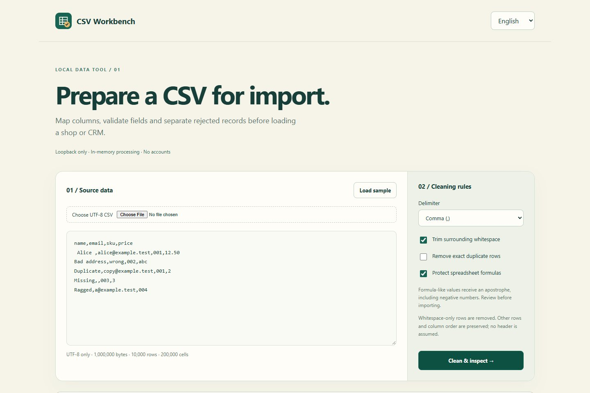

# CSV Workbench

[English](README.md) · [Русский](README.ru.md) · [Español](README.es.md)

Revisa y limpia archivos CSV antes de importarlos.

Contenido

[Funciones](#readme-features) · [Tecnologías](#readme-stack) · [Inicio rápido](#readme-start) · [Límites y privacidad](#readme-detail-01) · [Piloto comercial posible](#readme-detail-02) · [Verificación del 2026-10-29](#readme-detail-03) · [Autor](#readme-author) · [Licencia](#readme-license)

Interfaz local real con datos de demostración.

## Funciones

### Preparar una importación

Activa **Preparar importación → Leer columnas**. El primer registro no vacío es
el encabezado. Selecciona, renombra y ordena columnas; define campos obligatorios
y tipos (texto, entero, decimal con punto o formato básico de email).
Las columnas Clave forman una clave compuesta única que distingue mayúsculas;
se acepta la primera aparición válida y se rechazan claves vacías o repetidas.

**Preparar archivo de importación** genera `import-ready.csv`, un archivo separado
`rejected-records.csv` con motivos y celdas originales en JSON, y un informe JSON.
La vista previa muestra hasta 30 aceptados y 30 rechazados; las descargas incluyen
todos. Los valores siguen siendo texto: `001` no pierde sus ceros.
La validación de email no comprueba que el buzón exista. Máximo 200 columnas y
200.000 celdas proyectadas, además de los límites originales. La protección de
fórmulas también afecta a números negativos; revísala antes de importar.
El mapeo no se guarda fuera de la memoria de la pestaña. No se envían datos a
un CRM ni a una tienda automáticamente. El modo de limpieza original sigue disponible.

| Función | Comportamiento |
| --- | --- |
| Limpieza | Recorta espacios y elimina filas vacías |
| Duplicados | Eliminación opcional de duplicados exactos con recuentos |
| Exportación | CSV e informe JSON; protección de fórmulas activada |

Pega CSV o elige un archivo UTF-8. Selecciona coma, punto y coma o tabulación. Recorta espacios exteriores, elimina filas vacías y opcionalmente duplicados exactos. Revisa las primeras 30 filas y descarga el CSV completo y un informe JSON. No se presupone encabezado. Los duplicados se comparan después del recorte y antes de proteger fórmulas. Las filas de longitud distinta se conservan con una advertencia.

Interfaz EN/RU/ES según el idioma inicial del navegador; la elección manual se conserva localmente. Solo el idioma se guarda en localStorage.

## Tecnologías

| Componente | Código |
| --- | --- |
| Python stdlib, HTTP y CSV | [app.py](app.py) |
| JavaScript, descargas Blob, EN/RU/ES | [public/app.js](public/src/js/app.js) |
| HTML/CSS adaptable, SVG | [public/index.html](public/index.html), [public/style.css](public/src/css/style.css), [public/icon.svg](public/src/assets/icon.svg) |
| Pruebas del parser y HTTP | [tests/test_app.py](tests/test_app.py) |

## Inicio rápido

Instala Python 3.11+ manualmente; no hay dependencias externas ni instalación automática.

En Windows se usa `PYTHON_EXE`, el Python de Codex ya presente en el perfil del usuario o `py` / `python` instalados; no se descarga nada.

| Plataforma | Inicio |
| --- | --- |
| Windows | Doble clic en `Start.bat` o `Start.cmd` |
| macOS | `sh Start.command`; para doble clic, primero `chmod +x Start.command` |
| Ubuntu / macOS | `sh start.sh` o `make start` |
| Entorno con Python | `python app.py` |

Abre **http://127.0.0.1:8802** cuando aparezca en la terminal. Detén con Ctrl+C. Cambia el puerto: PowerShell `$env:PORT=8808; python app.py`; POSIX `PORT=8808 sh start.sh`. Solo escucha en 127.0.0.1. El arranque nativo de macOS requiere verificación; las pruebas Windows/WSL Ubuntu figuran abajo.

## Límites y privacidad

Según [app.py](app.py): 1.000.000 bytes UTF-8, 10.000 registros lógicos y 200.000 celdas; cuerpo JSON de hasta 2.200.000 bytes. El escape JSON puede alcanzar antes ese límite. No se truncan datos. El parser estricto de Python rechaza comillas sin cerrar y texto incorrecto tras el cierre; no valida semántica ni todos los dialectos. Puede aceptar comillas dentro de campos no entrecomillados.

La protección de fórmulas está activa: antepone apóstrofo a valores que comienzan por `=`, `+`, `-`, `@` o tabulación/salto de línea. También convierte números negativos en texto. Revisa el resultado en tu aplicación; no garantiza todos los importadores o transformaciones posteriores.

La aplicación procesa en memoria del navegador y Python sin guardar cargas en disco; el navegador guarda las descargas solicitadas. El sistema operativo puede usar swap o volcados, fuera del control de esta aplicación. Cierra la pestaña y detén el proceso al terminar.

Se validan Host/Origin, se exponen solo cuatro recursos estáticos y se admiten dos tareas simultáneas de procesamiento. No se registran cuerpos ni rutas de solicitudes. No publiques este servidor local con un proxy; no es un servicio multiusuario.

Ejecuta `python -m unittest discover -s tests -v` o `make test`. Comprueba campos multilínea, duplicados, fórmulas, CSV incorrecto, límites, filas irregulares, BOM, restricciones Host/Origin y archivos permitidos.

## Piloto comercial posible

**Hipótesis, sin demanda demostrada:** limpieza supervisada de CSV de productos o CRM antes de importarlos. Acuerda una muestra y criterios de aceptación; revisa y entrega archivo e informe. No valida emails, fusiona identidades ni implementa pagos o cuentas. No promete ingresos.

## Verificación del 2026-10-29

Las pruebas y el arranque real mediante BAT/shell pasaron en Windows y WSL Ubuntu. La ejecución en macOS sigue sin verificarse. Las pruebas del navegador usaron datos de demostración; se solicitó la descarga, pero no se verificó el guardado en la carpeta Descargas del sistema.

## Autor

[d9911](https://github.com/d9911) · [d9911.org](https://d9911.org).

## Licencia

Código propio y SVG: [MIT](LICENSE), copyright 2026 d9911. Python y los navegadores conservan sus licencias.
