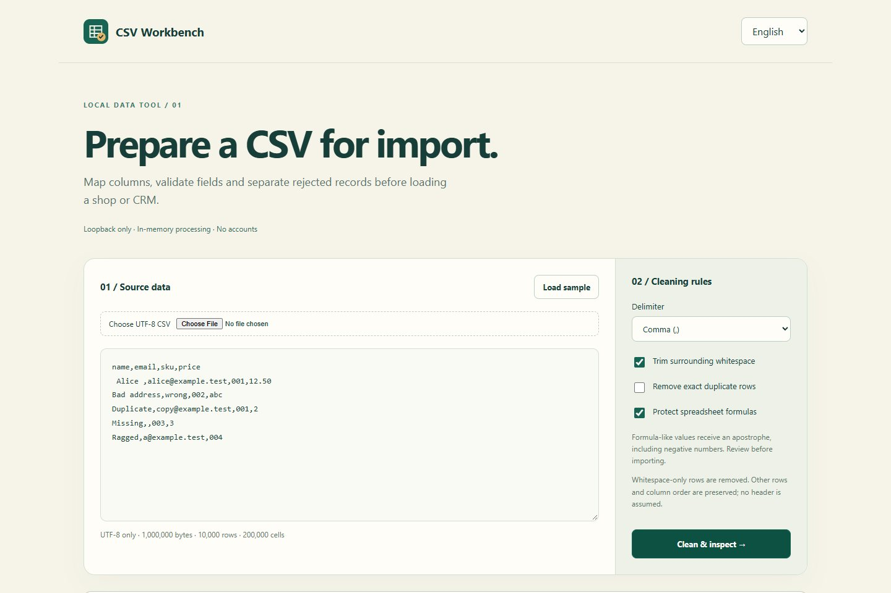

# CSV Workbench

[English](README.md) · [Russian](README.ru.md) · [Spanish](README.es.md)

Clean CSV files, validate columns and prepare imports.

Author: [d9911](https://github.com/d9911).

Run

Windows: `Start.cmd`

macOS / Linux: `sh start.sh`

[Open the app](http://127.0.0.1:8802/).

